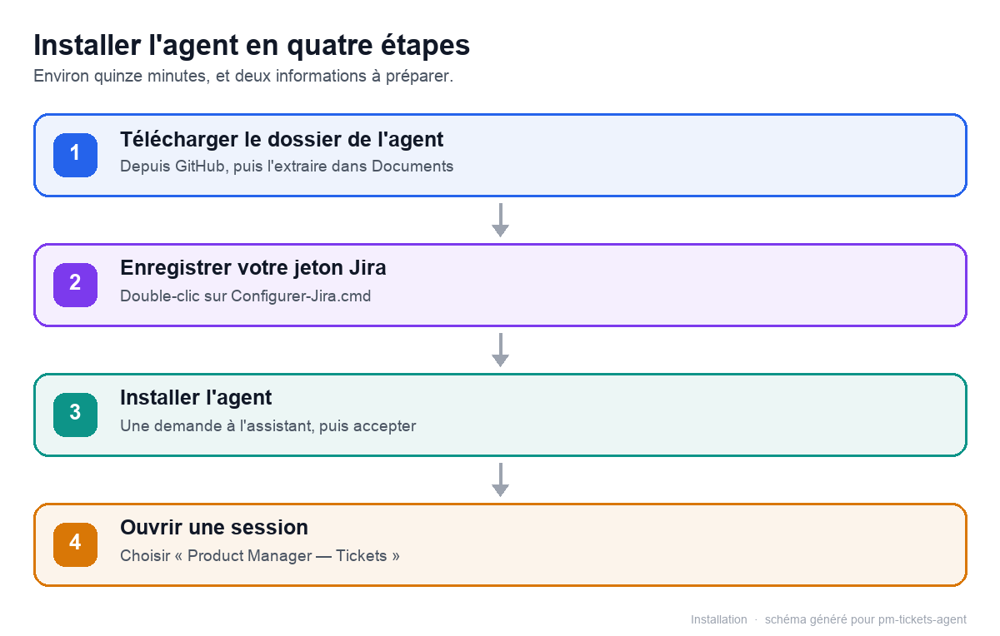

# PM Tickets — l'agent qui transforme vos idées en tickets Jira

**Pour les chefs de projet et les product managers.** Décrivez un besoin avec vos mots : l'agent le
cadre, vous pose les questions qu'un développeur poserait, rédige un ticket complet (user story,
critères d'acceptation, hors-périmètre, risques) et le crée dans **votre** projet Jira — après votre
validation, jamais avant.

> Un ticket que l'équipe comprend sans vous rappeler. Une conversation au lieu d'une page blanche.



---

## Ce que l'agent fait pour vous

| Sans l'agent | Avec l'agent |
|---|---|
| Vous partez d'une page blanche ou d'un vieux modèle | L'agent applique le gabarit de ticket de votre équipe, section par section |
| Les questions arrivent au refinement, le ticket est rouvert | L'agent pose les questions **avant** de rédiger : cas limites, erreurs, droits, impact |
| Le développeur doit deviner le contexte | Le contexte, le problème et le bénéfice attendu sont écrits noir sur blanc |
| Risque de doublon | L'agent cherche les tickets proches avant de créer |
| Le ticket atterrit dans le mauvais projet | L'agent crée uniquement dans le projet Jira que vous avez configuré |

Concrètement, l'agent :

- **cadre** votre demande : persona, bénéfice, périmètre, et vous pose jusqu'à trois questions si une
  information manque ;
- **questionne comme un développeur** : jusqu'à six questions de refinement (cas limites, formats,
  impact sur l'existant, droits, contraintes non fonctionnelles, testabilité) ;
- **s'appuie sur votre produit** : vos tickets types, votre documentation et votre dépôt de code,
  quand vous les avez fournis ;
- **rédige** un ticket complet en français : résumé, contexte et problème, user story, périmètre,
  critères d'acceptation au format Gherkin, hors-périmètre, dépendances et risques, Definition of
  Done, notes ;
- **fait valider** : il affiche le ticket dans la conversation et attend votre « oui » ;
- **crée** le ticket dans Jira et vous rend sa clé et son lien ;
- peut aussi **commenter** un ticket existant.

Ce qu'il ne fait pas : il ne modifie ni ne supprime un ticket existant sans confirmation, ne gère
pas vos sprints, et n'invente jamais une règle métier, une maquette ou une priorité. Une information
manquante devient une question ou une hypothèse nommée dans le ticket.

---

## Avant de commencer

Préparez trois choses :

1. **DeepSeek Harness installé sur votre poste.** C'est l'application dans laquelle l'agent vit
   (fournie par la DNUM). Si vous ne l'avez pas encore, demandez le guide d'installation
   « Documentation — Installation IA PM ».
2. **Un compte Atlassian (Jira Cloud) avec accès à votre projet Jira.** Vous devez pouvoir créer
   des tickets dans ce projet.
3. **L'accès au dépôt GitHub** `github.com/matleg29/Agent-ticket` (dépôt privé) : demandez l'accès
   au propriétaire du dépôt en lui communiquant votre identifiant GitHub. Sans accès, le lien
   ci-dessous renvoie une page 404.

Comptez **15 minutes**, dont 5 pour créer le jeton Jira.

> L'agent écrit toujours en français. Il conserve les valeurs Jira telles quelles : clé de projet,
> noms des types de ticket, statuts, libellés.

---

## Installation en quatre étapes (Windows)

### 1. Télécharger le dossier de l'agent

1. Ouvrez <https://github.com/matleg29/Agent-ticket> dans votre navigateur.
2. Cliquez sur **Code** (bouton vert), puis **Download ZIP**.
3. Dans votre dossier **Téléchargements**, faites un clic droit sur le fichier ZIP, puis
   **Extraire tout**.
4. Renommez le dossier extrait en **`Agent-ticket`** et déplacez-le dans **Documents**.

Vous devez obtenir un dossier `C:\Users\<votre-nom>\Documents\Agent-ticket` qui contient
`README.md`, `package.json` et le dossier `scripts`.

> **Ne déplacez plus ce dossier ensuite.** L'agent s'installe depuis cet emplacement ; si vous le
> déplacez, il faudra réinstaller l'agent.

### 2. Enregistrer votre jeton Jira

L'agent a besoin d'un **jeton API Atlassian**, une clé personnelle qui lui permet de parler à Jira
en votre nom. Il se crée une seule fois, et se révoque à tout moment.

1. Ouvrez <https://id.atlassian.com/manage-profile/security/api-tokens>.
2. Cliquez sur **Create API token**.
3. Donnez-lui un nom, par exemple `Agent PM Tickets`, puis cliquez sur **Create**.
4. **Copiez immédiatement** la valeur affichée : elle ne sera plus jamais visible ensuite.

Puis, dans le dossier `Agent-ticket` :

5. **Double-cliquez sur `Configurer-Jira.cmd`**.
6. Saisissez votre e-mail Atlassian, le nom de votre site Jira (par exemple `mon-entreprise` si
   votre Jira est sur `mon-entreprise.atlassian.net`) et collez le jeton. Le jeton reste masqué à la
   saisie.
7. Un message vert confirme l'enregistrement. **Double-cliquez sur `Verifier-Jira.cmd`** : le
   message « Connexion Jira OK » doit s'afficher.

> Le jeton est stocké uniquement sur votre poste, dans
> `C:\Users\<votre-nom>\.dsh\jira\credentials.env`. Il n'est jamais envoyé au modèle, ni affiché dans la conversation.

### 3. Faire installer l'agent dans DeepSeek Harness

1. Ouvrez **DeepSeek Harness**.
2. Démarrez une conversation avec l'agent **Standard** (celui par défaut, pas encore
   « Product Manager — Tickets »).
3. Copiez-collez ce message, en remplaçant `<votre-nom>` par le vôtre :

   > Installe le bundle `C:\Users\<votre-nom>\Documents\Agent-ticket`

   Astuce pour obtenir le chemin exact : dans l'Explorateur Windows, maintenez **Maj** enfoncée,
   faites un clic droit sur le dossier `Agent-ticket`, puis choisissez **Copier en tant que chemin
   d'accès**.
4. DeepSeek Harness demande une autorisation dite « accès complet » : c'est normal, installer un
   agent modifie la configuration de toutes vos conversations. **Acceptez.**
5. Attendez le message de confirmation. Si DeepSeek Harness indique qu'un redémarrage est
   nécessaire, **quittez puis rouvrez l'application**.

> Vous pouvez aussi installer l'agent depuis l'URL du dépôt si Git est installé sur votre poste :
> `Installe le bundle https://github.com/matleg29/Agent-ticket`. La méthode du dossier téléchargé
> reste la plus simple et la plus fiable.

### 4. Créer votre première session

1. Dans DeepSeek Harness, créez une **nouvelle conversation**.
2. Dans le sélecteur d'agent, choisissez **Product Manager — Tickets**.
3. Écrivez votre première demande, par exemple :

   > Mes clients ne peuvent pas suivre l'avancement de leur commande. Ils appellent le support pour
   > savoir où en est la livraison. Je voudrais qu'ils voient le statut depuis leur compte.

C'est parti. À la première conversation, l'agent vous pose quatre questions de mise en route (voir
ci-dessous) avant de rédiger.

---

## Le premier lancement : quatre questions

L'agent ne devine rien. Il vous demande, une question à la fois :

1. **Dans quel projet Jira dois-je créer vos tickets ?** — la clé du projet (par exemple
   `BOUTIQUE`), son nom ou l'adresse du projet. Si vous ne connaissez pas la clé, demandez-lui de
   lister vos projets accessibles. « Je ne sais pas encore » est une réponse valide : il redemandera
   au moment de créer le premier ticket.
2. **Où sont vos tickets types ?** — un dossier ou des fichiers Markdown qui montrent votre façon
   d'écrire, ou « je n'en ai pas ». L'agent imite leur structure et leur vocabulaire, jamais leur
   contenu.
3. **Où est la documentation produit ?** — un lien Notion, Confluence, site ou Google Doc partagé,
   ou un fichier/dossier Markdown local. Un PDF ou un Word n'est pas lisible directement ; donnez
   plutôt un lien ou un export.
4. **Quel est le dépôt GitHub du code ?** — l'adresse du dépôt, ou « pas de dépôt ». Pour un dépôt
   privé, une clé GitHub (`GITHUB_TOKEN`) est nécessaire ; dans le doute, répondez « pas de dépôt ».

Chaque réponse est enregistrée immédiatement. Un refus est une réponse complète : l'agent ne
redemandera pas. Tout est modifiable plus tard, sans réinstaller.

---

## Au quotidien

Décrivez le besoin, pas la solution :

> « Quand un client annule sa commande, il continue de recevoir les e-mails d'expédition. »

L'agent reformule, pose ses questions, rédige le ticket complet, puis demande :

> « Je crée ce ticket dans BOUTIQUE ? »

Vous corrigez, vous validez, il crée. Vous recevez la clé (`BOUTIQUE-123`) et le lien.

Trois réflexes qui font la différence :

- **Donnez le problème et le contexte**, pas seulement l'écran à modifier.
- **Répondez aux questions de refinement**, même par « je ne sais pas » : l'inconnue sera écrite
  dans le ticket, pas devinée.
- **Relisez les critères d'acceptation** avant de valider : c'est sur eux que l'équipe saura que le
  travail est terminé.

Le parcours complet est détaillé dans [docs/03-demander-un-ticket.md](docs/03-demander-un-ticket.md).

---

## Apprendre à l'agent votre façon d'écrire

Deux ou trois tickets représentatifs suffisent. Déposez-les dans
`C:\Users\<votre-nom>\.dsh\pm-tickets\examples\` (un fichier `.md` par ticket, nommé
`story-<sujet>.md`, `bug-<sujet>.md` ou `task-<sujet>.md`), ou copiez-les avec :

```powershell
powershell -ExecutionPolicy Bypass -File scripts\add-example.ps1 -Source C:\chemin\mon-ticket.md
```

L'agent relit ce dossier à chaque rédaction : la prise en compte est immédiate, sans réinstallation.
Ses exemples prioritaires sont, dans l'ordre : un exemple collé dans la conversation, vos fichiers
personnels, puis les exemples livrés avec l'agent.

Le mode d'emploi complet est dans [examples/nomenclature.md](examples/nomenclature.md).

---

## Vos identifiants restent chez vous

| Donnée | Où elle vit |
|---|---|
| Votre jeton Jira | `C:\Users\<votre-nom>\.dsh\jira\credentials.env` (protégé) |
| Votre configuration (projet, doc, dépôt) | `C:\Users\<votre-nom>\.dsh\pm-tickets\config.json` |
| Vos tickets d'exemple | `C:\Users\<votre-nom>\.dsh\pm-tickets\examples\` |
| Le programme qui parle à Jira | `C:\Users\<votre-nom>\.dsh\pm-tickets\runtime\mcp\` |

Vos identifiants et vos réglages ne quittent jamais votre poste. Les textes que vous confiez à
l'agent (votre demande, votre documentation, vos tickets d'exemple) sont traités par le modèle d'IA
de DeepSeek Harness, comme dans toute conversation ; le jeton Jira, lui, n'est jamais transmis au
modèle. L'agent ne met jamais de secret dans un ticket.

---

## Mettre à jour, désinstaller

**Mettre à jour** — téléchargez la nouvelle version du dépôt, remplacez le contenu du dossier
`Agent-ticket` (gardez le même chemin), puis quittez et rouvrez DeepSeek Harness. Si le nom du
paquet a changé, demandez d'abord à l'assistant : « Retire le bundle pm-ticket-agents », puis
réinstallez.

**Désinstaller** — dans une conversation avec l'agent **Standard**, demandez : « Retire le bundle
pm-ticket-agents ». Le preset disparaît du sélecteur. Vos réglages et votre jeton restent dans
votre dossier personnel ; supprimez-les à la main si vous le souhaitez.

---

## Dépannage

| Symptôme | Cause probable | Action |
|---|---|---|
| « Product Manager — Tickets » absent du sélecteur | Installation non terminée, ou application non redémarrée | Rouvrez DeepSeek Harness ; sinon refaites l'étape 3 et vérifiez le message de confirmation |
| « Identifiants Jira manquants » | Jeton non enregistré ou fichier déplacé | Relancez `Configurer-Jira.cmd` |
| Erreur **401** | Jeton refusé, révoqué ou copié tronqué | Créez un nouveau jeton et relancez `Configurer-Jira.cmd` |
| Erreur **403** | Votre compte n'a pas les droits sur le projet | Demandez les droits au propriétaire du projet Jira |
| Erreur **400** à la création | Type de ticket ou priorité inexistant dans le projet | Demandez à l'agent la liste des types disponibles, puis revalidez |
| « bundle introuvable » à l'installation | Chemin incomplet, dossier déplacé, ou ZIP non extrait | Vérifiez que le dossier contient `package.json`, puis recopiez son chemin exact |
| Windows affiche un avertissement à l'ouverture de `Configurer-Jira.cmd` | Fichier téléchargé depuis Internet | Cliquez sur « Informations complémentaires », puis « Exécuter quand même » |
| Les outils Jira sont indisponibles | Serveur local non préparé, ou redémarrage manquant | Quittez et rouvrez DeepSeek Harness ; vérifiez que le dossier `.dsh\pm-tickets\runtime\mcp` existe |
| Le ticket part dans le mauvais projet | Projet de mise en route incorrect | Demandez à l'agent : « change le projet Jira pour … » |

Le guide de dépannage détaillé est dans [docs/04-depannage.md](docs/04-depannage.md).

---

## Documentation

| Page | Contenu |
|---|---|
| [Découvrir et installer](docs/01-decouvrir-et-installer.md) | Le parcours d'installation pas à pas, avec les schémas |
| [Configurer l'agent](docs/02-configurer-l-agent.md) | Les quatre questions, vos exemples, la documentation produit |
| [Demander un ticket](docs/03-demander-un-ticket.md) | Le déroulé d'une demande, du cadrage à la création |
| [Dépannage](docs/04-depannage.md) | Connexion Jira, messages d'erreur, questions fréquentes |
| [Pour aller plus loin](docs/05-pour-aller-plus-loin.md) | Les dix actions de l'agent et l'architecture |

---

## Contenu du dépôt

| Élément | Rôle |
|---|---|
| `package.json` | Manifeste du bundle installable par DeepSeek Harness |
| `cordis.patch.yml` | Déclaration du preset « Product Manager — Tickets » : persona, outils, connexion Jira |
| `index.js` | Prépare le serveur Jira local et le mode d'exécution par défaut de l'agent |
| `mcp/jira-mcp.mjs` | Serveur local (MCP) qui parle à l'API Jira : recherche, création, commentaire, contexte |
| `examples/` | Tickets de référence livrés par défaut |
| `scripts/` | Programmes d'enregistrement du jeton, de vérification, d'ajout d'exemples (Windows et macOS) |
| `docs/` | Les cinq guides et leurs schémas |
| `Configurer-Jira.cmd`, `Verifier-Jira.cmd` | Raccourcis Windows à double-cliquer |

---

## Sous le capot (pour les équipes techniques)

- **Technologie** : bundle de plugins pour DeepSeek Harness (preset d'agent + serveur MCP local en
  Node.js). Aucune dépendance à installer : le serveur tourne avec le Node embarqué dans DeepSeek
  Harness.
- **Aucun chemin personnel dans le dépôt.** Le serveur Jira est copié au chargement dans
  `~/.dsh/pm-tickets/runtime/` avec les exemples livrés ; le patch le lance via `process.execPath`, donc macOS comme Windows.
- **Authentification** : HTTP Basic `e-mail:jeton` sur l'API REST Jira v3 (Atlassian Cloud). Les
  identifiants sont lus dans `~/.dsh/jira/credentials.env`, jamais dans la conversation.
- **Pas de collecte** : le serveur n'écrit que la configuration locale et ne contacte que Jira et,
  si configuré, l'API GitHub.
- **Compatibilité** : DeepSeek Harness Desktop 0.2.x. Les scripts Windows utilisent PowerShell
  (fourni avec Windows) ; les scripts macOS utilisent bash.
- **Installation** : `plugin_manager`, action `install_bundle`, avec le dossier du dépôt ou son URL
  comme cible. Désinstallation : `remove_bundle`, cible `pm-ticket-agents`.

---

## Licence et contributions

Dépôt personnel, privé, destiné aux chefs de projet et PM qui l'utilisent en interne. Les
améliorations sont bienvenues : ouvrez une *issue* ou une *pull request* sur
<https://github.com/matleg29/Agent-ticket>.
