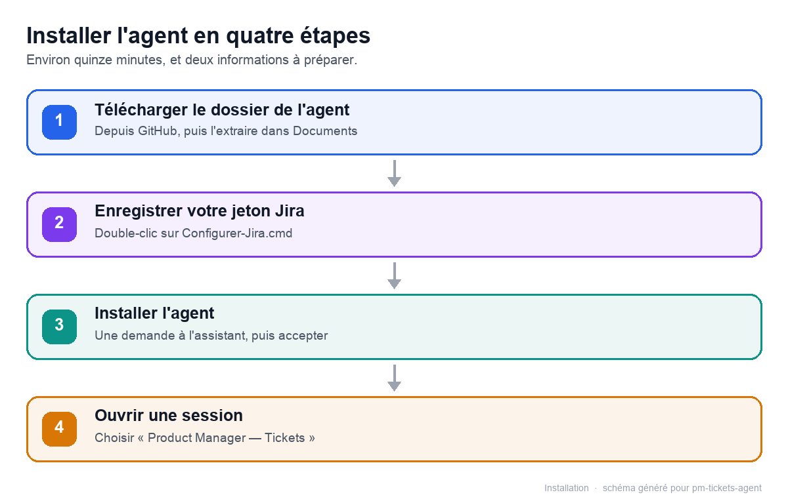

# PM Tickets — l'agent qui transforme vos idées en tickets Jira

**Pour les chefs de projet et les product managers.** Décrivez un besoin avec vos mots : l'agent le
cadre, vous pose les questions qu'un développeur poserait, rédige un ticket synthétique et le crée
dans **votre** projet Jira — après votre validation, jamais avant.

> Un ticket que l'équipe comprend sans vous rappeler. Une conversation au lieu d'une page blanche.

---

## Ce que l'agent fait pour vous

| Sans l'agent | Avec l'agent |
|---|---|
| Vous partez d'une page blanche ou d'un vieux modèle | L'agent applique le gabarit du ticket, section par section, dans un ordre fixe |
| Les questions arrivent au refinement, le ticket est rouvert | L'agent pose les questions **avant** de rédiger : cas limites, erreurs, droits, impact |
| Un ticket de trois pages que personne ne lit | Un ticket à puces, lisible en 30 secondes |
| Risque de doublon | L'agent cherche les tickets proches avant de créer |
| Le parcours du besoin reste dans la tête du PM | L'agent joint un logigramme fonctionnel en commentaire du ticket créé |
| Le ticket atterrit dans le mauvais projet | L'agent crée uniquement dans le projet Jira que vous avez configuré |

Concrètement, l'agent :

- **cadre** votre demande : persona, bénéfice, périmètre, et vous pose jusqu'à trois questions si une
  information manque ;
- **questionne comme un développeur** : jusqu'à six questions de refinement (cas limites, formats,
  impact sur l'existant, droits, contraintes non fonctionnelles, testabilité) ;
- **s'appuie sur votre produit** : vos tickets types, votre documentation et votre dépôt de code,
  quand vous les avez fournis ;
- **rédige** un ticket synthétique en français, à puces, en dix sections : résumé, contexte, user
  story, périmètre, critères d'acceptation au format Gherkin français, exigences non fonctionnelles,
  hors périmètre, hypothèses et questions ouvertes, risques et dépendances, notes. Budget
  indicatif : 2 200 caractères ;
- **relit avant d'afficher** : huit contrôles, du critère testable au budget respecté, et corrige ce
  qui échoue avant de vous montrer le ticket ;
- **accompagne le ticket d'un logigramme fonctionnel** : le parcours du besoin en cases et en
  décisions, déduit des critères, présenté en deux formats (texte lisible partout, source Mermaid)
  et déposé en commentaire du ticket après sa création ;
- **fait valider** : il affiche le ticket et son logigramme dans la conversation et attend votre « oui » ;
- **crée** le ticket dans Jira et vous rend sa clé et son lien.

Ce qu'il ne fait pas : il **ne modifie et ne supprime jamais** un ticket existant, ne gère pas vos
sprints, et n'invente jamais une règle métier, une maquette ou une priorité. Une information
manquante devient une question ou une hypothèse nommée dans le ticket.

---

## Avant de commencer : deux prérequis

1. **DeepSeek Harness installé sur votre poste.** C'est l'application dans laquelle l'agent vit
   (fournie par la DNUM). Si vous ne l'avez pas encore, demandez le guide d'installation
   « Documentation — Installation IA PM ».
2. **Le MCP Jira installé et authentifié AVANT l'agent.** C'est le petit programme qui relie votre
   poste à Jira. Une fois pour toutes : la section « Étape 0 — le prérequis Jira » de
   [docs/01-decouvrir-et-installer.md](docs/01-decouvrir-et-installer.md) vous fait installer ce
   programme et enregistrer votre accès (raccourcis `Configurer-Jira.cmd` et `Verifier-Jira.cmd`).
   L'agent, lui, ne configure aucun identifiant et ne demande ni site Atlassian, ni e-mail, ni jeton.



Légende : le prérequis Jira (case 2 : enregistrer le jeton), le dossier à télécharger (case 1),
l'installation de l'agent (case 3) et la première session (case 4). Le prérequis se fait avant
l'installation ; l'agent ne configure aucun identifiant.

Prévoyez un **compte Atlassian (Jira Cloud)** avec le droit de créer des tickets dans votre projet,
et l'**accès au dépôt GitHub** `github.com/matleg29/Agent-ticket` (dépôt privé) : demandez l'accès au
propriétaire du dépôt en lui communiquant votre identifiant GitHub.

Comptez **10 minutes** pour installer l'agent, une fois le prérequis Jira en place.

> L'agent écrit toujours en français. Il conserve les valeurs Jira telles quelles : clé de projet,
> noms des types de ticket, statuts, libellés.

---

## Droits sur Jira : création seule

- L'agent **crée** des tickets. C'est tout.
- Il ne modifie **jamais** un ticket existant : ni résumé, ni description, ni statut, ni priorité, ni
  libellé, ni assignation, ni pièce jointe.
- Il ne supprime **jamais** de ticket. Aucune exception, aucun « pour cette fois ».
- Seule écriture sur un ticket existant : un commentaire sur **le ticket qu'il vient de créer** dans
  la conversation en cours, pour y déposer le logigramme fonctionnel.
- Besoin de changer quelque chose ? L'agent décrit en une ou deux phrases ce qu'il faudrait changer,
  **vous donne le lien** du ticket (`.../browse/CLÉ`) et vous laisse faire dans Jira.

Formulation que vous verrez : « Je ne modifie pas les tickets existants. Voici le lien : <URL>. La
modification est à faire côté Jira, par vous. »

| Ce que l'agent fait | Ce qu'il ne fait jamais |
|---|---|
| Lire les tickets proches pour éviter les doublons | Modifier un ticket existant |
| Créer un ticket après votre validation | Supprimer un ticket |
| Commenter le ticket qu'il vient de créer | Commenter un ticket créé par quelqu'un d'autre |
| Vous fournir la clé et le lien du ticket | Changer un statut, une priorité, un libellé |

---

## Style du ticket : synthétique, à puces

Le ticket est court et dense : ce qu'un développeur lit en 30 secondes.

Gabarit appliqué, dans cet ordre :

1. **Résumé** — une phrase, 100 caractères au plus, sans préfixe de type.
2. **Contexte** — 2 à 4 puces : qui est concerné, situation actuelle, impact.
3. **User story** — une phrase : « En tant que…, je veux…, afin de… ».
4. **Périmètre** — 3 à 6 puces, verbes d'action.
5. **Critères d'acceptation** — Gherkin français, une ligne par critère : `Étant donné … / Quand … /
   Alors …`. Au minimum un cas nominal, plus un cas limite et un cas d'erreur dès que le parcours
   peut échouer ; 8 critères au maximum. Chaque critère porte une valeur observable.
6. **Exigences non fonctionnelles** — puces : performance, volumétrie, accessibilité, mobile, langue,
   sécurité, conservation. **Section omise** seulement si aucune ne s'applique, et l'omission se
   justifie alors en **Notes**.
7. **Hors périmètre** — puces. **Section omise** si elle est vide.
8. **Hypothèses et questions ouvertes** — une ligne par hypothèse :
   `Hypothèse : <énoncé> — si faux, alors <impact concret>.` **Section omise** si elle est vide.
9. **Risques et dépendances** — puces. **Section omise** si elle est vide.
10. **Notes** — puces : liens, maquettes, `Source :`, `Demandeur :`. **Section omise** si elle est vide.

Les sections 6 à 10 sont les seules facultatives : une section vide est une faute de style, son
absence n'en est pas une. Après le ticket, et hors de la description, deux lignes de décision sont
toujours données : `Type proposé : Story | Task | Bug — <justification>` et `Priorité proposée :
<niveau> — <justification>`.

Règles de concision :

- Une idée = une puce = une ligne.
- Pas de phrase d'introduction, pas de reformulation de la demande, pas de résumé final.
- Budget indicatif : **2 200 caractères** hors logigramme. Si ça dépasse, coupez dans cet ordre :
  **Notes**, puis **Hors périmètre**, puis **Contexte**. Jamais dans les critères d'acceptation, les
  exigences non fonctionnelles ni les hypothèses : si ces sections débordent, le ticket est trop
  large, on le découpe.
- La structure vient du gabarit : vos exemples fournissent le vocabulaire, le ton et le niveau de
  détail, jamais une section ajoutée, retirée ou renommée.
- Pas d'adjectif creux, pas de « etc. », pas de « TBD », pas de section vide.
- La « Definition of Done » séparée n'existe plus : ce qui reste utile va dans une puce de **Notes**.
- Le logigramme fonctionnel reste **hors** de la description : il part en commentaire du ticket créé.
  Il se déduit des critères d'acceptation : une branche = un critère, et réciproquement.

---

## Installation en trois étapes (Windows)

> Le prérequis Jira (étape « Avant de commencer ») est fait : le MCP Jira est installé et authentifié.

### 1. Télécharger le dossier de l'agent

1. Ouvrez <https://github.com/matleg29/Agent-ticket> dans votre navigateur.
2. Cliquez sur **Code** (bouton vert), puis **Download ZIP**.
3. Dans votre dossier **Téléchargements**, faites un clic droit sur le fichier ZIP, puis
   **Extraire tout**.
4. Renommez le dossier extrait en **`Agent-ticket`** et déplacez-le dans **Documents**.

Vous devez obtenir un dossier `C:\Users\<votre-nom>\Documents\Agent-ticket` qui contient
`README.md`, `package.json` et le dossier `scripts`.

> **Ne déplacez plus ce dossier ensuite.** L'agent s'installe depuis cet emplacement ; si vous le
> déplacez, il faudra réinstaller l'agent.

### 2. Faire installer l'agent dans DeepSeek Harness

1. Ouvrez **DeepSeek Harness**.
2. Démarrez une conversation avec l'agent **Standard** (celui par défaut, pas encore
   « Product Manager — Tickets »).
3. Copiez-collez ce message, en remplaçant `<votre-nom>` par le vôtre :

   > Installe le bundle `C:\Users\<votre-nom>\Documents\Agent-ticket`

   Astuce pour obtenir le chemin exact : dans l'Explorateur Windows, maintenez **Maj** enfoncée,
   faites un clic droit sur le dossier `Agent-ticket`, puis choisissez **Copier en tant que chemin
   d'accès**.
4. DeepSeek Harness demande une autorisation dite « accès complet » : c'est normal, installer un
   agent modifie la configuration de toutes vos conversations. **Acceptez.**
5. Attendez le message de confirmation. Si DeepSeek Harness indique qu'un redémarrage est
   nécessaire, **quittez puis rouvrez l'application**.

> Vous pouvez aussi installer l'agent depuis l'URL du dépôt si Git est installé sur votre poste :
> `Installe le bundle https://github.com/matleg29/Agent-ticket`. La méthode du dossier téléchargé
> reste la plus simple et la plus fiable.

### 3. Créer votre première session

1. Dans DeepSeek Harness, créez une **nouvelle conversation**.
2. Dans le sélecteur d'agent, choisissez **Product Manager — Tickets**.
3. Écrivez votre première demande, par exemple :

   > Mes clients ne peuvent pas suivre l'avancement de leur commande. Ils appellent le support pour
   > savoir où en est la livraison. Je voudrais qu'ils voient le statut depuis leur compte.

C'est parti. À la première conversation, l'agent vous pose quatre questions de mise en route (voir
ci-dessous) avant de rédiger.

### Sur macOS

Le parcours est identique : même dossier, même message d'installation, en donnant le chemin du
dossier téléchargé (par exemple `~/Documents/Agent-ticket`). Le prérequis Jira s'installe de la même
façon, avec les scripts fournis pour macOS.

---

## Le premier lancement : quatre questions

L'agent ne devine rien. Il vous demande, une question à la fois. Aucune de ces questions ne porte sur
vos identifiants : le prérequis Jira les a déjà enregistrés.

1. **Dans quel projet Jira dois-je créer vos tickets ?** — la clé du projet (par exemple
   `BOUTIQUE`), son nom ou l'adresse du projet. Si vous ne connaissez pas la clé, demandez-lui de
   lister vos projets accessibles. « Je ne sais pas encore » est une réponse valide : il redemandera
   au moment de créer le premier ticket.
2. **Où sont vos tickets types ?** — un dossier ou des fichiers Markdown qui montrent votre façon
   d'écrire, ou « je n'en ai pas ». L'agent en reprend le vocabulaire, le ton et le niveau de détail,
   jamais le contenu ; la structure reste celle du gabarit.
3. **Où est la documentation produit ?** — un lien Notion, Confluence, site ou Google Doc partagé,
   ou un fichier/dossier Markdown local. Un PDF ou un Word n'est pas lisible directement ; donnez
   plutôt un lien ou un export.
4. **Quel est le dépôt GitHub du code ?** — l'adresse du dépôt, ou « pas de dépôt ». Pour un dépôt
   privé, une clé GitHub (`GITHUB_TOKEN`) est nécessaire ; dans le doute, répondez « pas de dépôt ».

Chaque réponse est enregistrée immédiatement. Un refus est une réponse complète : l'agent ne
redemandera pas. Tout est modifiable plus tard, sans réinstaller.

---

## Au quotidien

Décrivez le besoin, pas la solution :

> « Quand un client annule sa commande, il continue de recevoir les e-mails d'expédition. »

L'agent reformule, pose ses questions, rédige le ticket, puis demande :

> « Je crée ce ticket dans BOUTIQUE ? »

Vous corrigez, vous validez, il crée. Vous recevez la clé (`BOUTIQUE-123`) et le lien.

Trois réflexes qui font la différence :

- **Donnez le problème et le contexte**, pas seulement l'écran à modifier.
- **Répondez aux questions de refinement**, même par « je ne sais pas » : l'inconnue sera écrite
  dans le ticket, pas devinée.
- **Relisez les critères d'acceptation** avant de valider : c'est sur eux que l'équipe saura que le
  travail est terminé.

Le parcours complet est détaillé dans [docs/03-demander-un-ticket.md](docs/03-demander-un-ticket.md).

---

## Apprendre à l'agent votre façon d'écrire

Deux ou trois tickets représentatifs suffisent. Déposez-les dans
`C:\Users\<votre-nom>\.dsh\pm-tickets\examples\` (un fichier `.md` par ticket, nommé
`story-<sujet>.md`, `bug-<sujet>.md` ou `task-<sujet>.md`), ou copiez-les avec :

```powershell
powershell -ExecutionPolicy Bypass -File scripts\add-example.ps1 -Source C:\chemin\mon-ticket.md
```

L'agent relit ce dossier à chaque rédaction : la prise en compte est immédiate, sans réinstallation.
Ses exemples prioritaires sont, dans l'ordre : un exemple collé dans la conversation, vos fichiers
personnels, puis les exemples livrés avec l'agent.

Le mode d'emploi complet est dans [examples/nomenclature.md](examples/nomenclature.md).

---

## Vos identifiants restent chez vous

| Donnée | Où elle vit |
|---|---|
| Votre accès Jira (prérequis MCP) | `C:\Users\<votre-nom>\.dsh\jira\credentials.env` (protégé) |
| Votre configuration (projet, doc, dépôt) | `C:\Users\<votre-nom>\.dsh\pm-tickets\config.json` |
| Vos tickets d'exemple | `C:\Users\<votre-nom>\.dsh\pm-tickets\examples\` |
| Le programme qui parle à Jira | `C:\Users\<votre-nom>\.dsh\pm-tickets\runtime\mcp\` |

L'accès Jira est enregistré une seule fois, par le prérequis MCP, et n'est jamais transmis au modèle.
Les textes que vous confiez à l'agent (votre demande, votre documentation, vos tickets d'exemple) sont
traités par le modèle d'IA de DeepSeek Harness, comme dans toute conversation. L'agent ne met jamais
de secret dans un ticket et ne vous demande jamais de jeton.

---

## Mettre à jour, désinstaller

**Mettre à jour** — téléchargez la nouvelle version du dépôt, remplacez le contenu du dossier
`Agent-ticket` (gardez le même chemin), puis quittez et rouvrez DeepSeek Harness. Si le nom du
paquet a changé, demandez d'abord à l'assistant : « Retire le bundle pm-ticket-agents », puis
réinstallez.

**Désinstaller** — dans une conversation avec l'agent **Standard**, demandez : « Retire le bundle
pm-ticket-agents ». Le preset disparaît du sélecteur. Vos réglages restent dans votre dossier
personnel ; supprimez-les à la main si vous le souhaitez. Le prérequis Jira n'est pas concerné.

---

## Dépannage

| Symptôme | Cause probable | Action |
|---|---|---|
| « Product Manager — Tickets » absent du sélecteur | Installation non terminée, ou application non redémarrée | Rouvrez DeepSeek Harness ; sinon refaites l'étape 2 et vérifiez le message de confirmation |
| « Identifiants Jira manquants » | Le prérequis Jira n'a pas été fait sur ce poste | Refaites le prérequis Jira (voir « Avant de commencer : deux prérequis » ci-dessus), puis rouvrez DeepSeek Harness |
| Erreur **401** | Accès Jira refusé, révoqué ou copié tronqué | Refaites le prérequis Jira avec un accès valide |
| Erreur **403** | Votre compte n'a pas les droits sur le projet | Demandez les droits au propriétaire du projet Jira |
| Erreur **400** à la création | Type de ticket ou priorité inexistant dans le projet | Demandez à l'agent la liste des types disponibles, puis revalidez |
| « bundle introuvable » à l'installation | Chemin incomplet, dossier déplacé, ou ZIP non extrait | Vérifiez que le dossier contient `package.json`, puis recopiez son chemin exact |
| Les outils Jira sont indisponibles | MCP Jira non installé, ou redémarrage manquant | Refaites le prérequis Jira, puis quittez et rouvrez DeepSeek Harness |
| Le ticket part dans le mauvais projet | Projet de mise en route incorrect | Demandez à l'agent : « change le projet Jira pour … » |
| J'ai besoin de corriger un ticket créé | C'est voulu : l'agent ne modifie rien | Ouvrez le lien fourni et faites la modification vous-même dans Jira |
| Le logigramme du ticket apparaît en code brut | Jira Cloud ne dessine pas Mermaid nativement | Lisez la version texte du commentaire : elle décrit le même parcours ; pour l'image, installez une application Mermaid depuis le Marketplace Atlassian |

Le guide de dépannage détaillé est dans [docs/04-depannage.md](docs/04-depannage.md).

---

## Documentation

| Page | Contenu |
|---|---|
| [Découvrir et installer](docs/01-decouvrir-et-installer.md) | Le prérequis Jira, puis l'installation de l'agent, pas à pas |
| [Configurer l'agent](docs/02-configurer-l-agent.md) | Le projet Jira et les trois sources : exemples, documentation, dépôt |
| [Demander un ticket](docs/03-demander-un-ticket.md) | Le déroulé d'une demande, le gabarit et les droits |
| [Dépannage](docs/04-depannage.md) | Prérequis Jira, messages d'erreur, questions fréquentes |
| [Pour aller plus loin](docs/05-pour-aller-plus-loin.md) | Les dix actions de l'agent et l'architecture |

---

## Contenu du dépôt

| Élément | Rôle |
|---|---|
| `package.json` | Manifeste du bundle installable par DeepSeek Harness |
| `cordis.patch.yml` | Déclaration du preset « Product Manager — Tickets » : persona, outils, accès au MCP Jira |
| `index.js` | Prépare le mode d'exécution par défaut de l'agent |
| `mcp/jira-mcp.mjs` | Serveur local (MCP) qui parle à l'API Jira : recherche, création, commentaire, contexte |
| `examples/` | Tickets de référence livrés par défaut |
| `scripts/` | Prérequis Jira (identifiants, vérification) et ajout d'exemples, Windows et macOS |
| `docs/` | Les cinq guides et leurs schémas |
| `Configurer-Jira.cmd`, `Verifier-Jira.cmd` | Raccourcis Windows du prérequis Jira, à double-cliquer |

---

## Sous le capot (pour les équipes techniques)

- **Technologie** : bundle de plugins pour DeepSeek Harness (preset d'agent + serveur MCP local en
  Node.js). Aucune dépendance à installer : le serveur tourne avec le Node embarqué dans DeepSeek
  Harness.
- **Aucun chemin personnel dans le dépôt.** Le serveur Jira est copié au chargement dans
  `~/.dsh/pm-tickets/runtime/` avec les exemples livrés ; le patch le lance via `process.execPath`, donc macOS comme Windows.
- **Accès Jira** : il relève du prérequis MCP — HTTP Basic `e-mail:jeton` sur l'API REST Jira v3
  (Atlassian Cloud), identifiants lus dans `~/.dsh/jira/credentials.env` par le serveur MCP, jamais
  dans la conversation. L'agent ne configure ni ne lit ces identifiants.
- **Périmètre d'écriture** : le serveur n'expose que la recherche, la lecture, la création et le
  commentaire. Aucun outil de mise à jour ou de suppression n'est exposé.
- **Pas de collecte** : le serveur n'écrit que la configuration locale et ne contacte que Jira et,
  si configuré, l'API GitHub.
- **Compatibilité** : DeepSeek Harness Desktop 0.2.x. Les scripts Windows utilisent PowerShell
  (fourni avec Windows) ; les scripts macOS utilisent bash.
- **Installation** : `plugin_manager`, action `install_bundle`, avec le dossier du dépôt ou son URL
  comme cible. Désinstallation : `remove_bundle`, cible `pm-ticket-agents`.

---

## Licence et contributions

Dépôt personnel, privé, destiné aux chefs de projet et PM qui l'utilisent en interne. Les
améliorations sont bienvenues : ouvrez une *issue* ou une *pull request* sur
<https://github.com/matleg29/Agent-ticket>.
