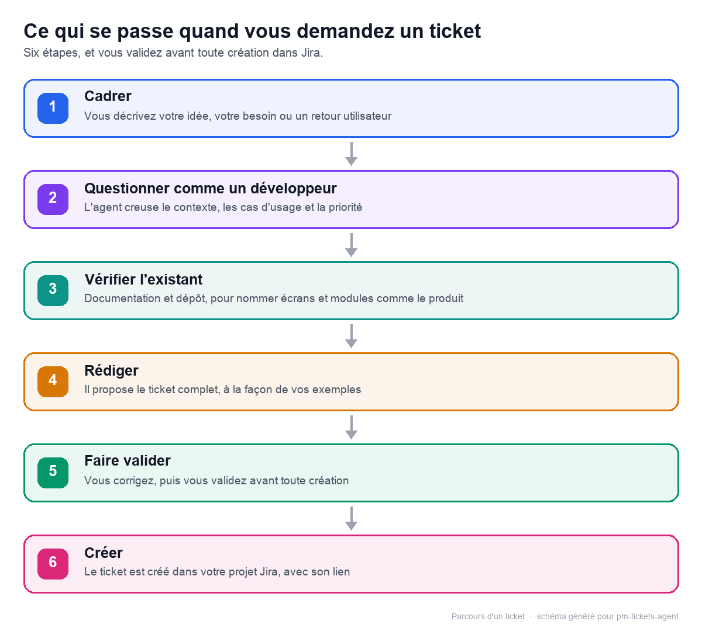
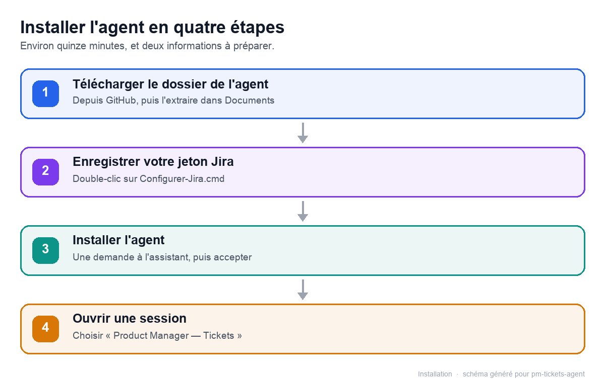

# Découvrir et installer l'agent

## En une minute

- L'agent « Product Manager — Tickets » transforme vos idées en tickets Jira synthétiques, rédigés en français.
- Avant de rédiger, il pose les questions qu'un développeur poserait, puis il attend votre accord avant de créer quoi que ce soit.
- Un prérequis d'abord : le **MCP Jira** doit être installé et authentifié sur votre poste. Ensuite, comptez dix minutes pour installer l'agent.

## Ce que l'agent fait

- Il rédige un ticket à puces à partir d'une idée, d'un besoin métier ou d'un retour utilisateur : gabarit en huit sections, 1 500 caractères au plus.
- Avant d'écrire, il se met à la place du développeur qui lira le ticket et pose jusqu'à six questions : cas limites et erreurs, données et formats, impact sur l'existant, droits, contraintes non fonctionnelles, testabilité.
- Un « je ne sais pas » devient une hypothèse ou une question ouverte, écrite dans le ticket.
- Il cherche les tickets proches pour éviter les doublons et vous signale l'existant.
- Il ne choisit jamais le projet à votre place : il crée uniquement dans le projet que vous avez configuré, après votre confirmation.
- Il ne modifie et ne supprime **jamais** un ticket existant : il vous donne le lien et la modification se fait dans Jira, par vous.
- Il ne gère ni les sous-tâches ni les sprints.

## Le déroulé d'une demande

1. **Cadrer** — l'agent reformule votre demande et précise le bénéfice visé.
2. **Questionner comme un développeur** — jusqu'à six questions ; vos réponses rendent le premier jet pertinent et vous préparent au refinement.
3. **Vérifier l'existant** — recherche des tickets proches, pour éviter un doublon.
4. **Rédiger** — un ticket synthétique à puces, avec les hypothèses et les questions ouvertes visibles.
5. **Faire valider** — vous relisez, vous corrigez, l'agent ajuste.
6. **Créer** — après votre confirmation, le ticket apparaît dans Jira avec sa clé et son lien.

Légende : votre demande avance d'étape en étape jusqu'à la création ; vous validez avant toute écriture dans Jira.

## Étape 0 — le prérequis Jira (avant l'agent)

Le MCP Jira est le petit programme qui relie votre poste à Jira. **Il s'installe et s'authentifie
avant l'agent.** Une fois pour toutes.

Légende : le prérequis Jira (case 2 : enregistrer le jeton), le dossier à télécharger (case 1),
l'installation de l'agent (case 3) et la première session (case 4). Le prérequis se fait avant
l'installation ; l'agent ne configure aucun identifiant.

- Utilisez les scripts du prérequis fournis dans ce dépôt : `Configurer-Jira.cmd` puis
  `Verifier-Jira.cmd` (macOS : `bash scripts/set-jira-credentials.sh`, puis `bash scripts/check-jira.sh`).
- Vous y enregistrez votre accès : site Atlassian, e-mail, jeton API. **C'est le prérequis qui le fait, pas l'agent.**
- Vérifiez à la fin que la connexion est établie : le prérequis affiche un message de confirmation.
- Prévoyez un **compte Atlassian (Jira Cloud)** avec le droit de créer des tickets dans votre projet.

> Si le prérequis n'est pas fait, l'agent s'affiche mais ne peut pas parler à Jira. Il vous le dit en
> une phrase et vous renvoie au prérequis : il ne configure aucun identifiant.

## Installer l'agent

Préparez deux choses : **DeepSeek Harness** installé sur votre poste, et l'**accès au dépôt GitHub**
`github.com/matleg29/Agent-ticket` (dépôt privé — demandez l'accès au propriétaire en lui communiquant
votre identifiant GitHub). Le prérequis Jira (accès enregistré, connexion vérifiée) se fait avant :
voir la section « Étape 0 — le prérequis Jira » ci-dessus, schéma compris.

### 1. Télécharger le dossier de l'agent

- Ouvrez <https://github.com/matleg29/Agent-ticket>.
- Cliquez sur **Code**, puis **Download ZIP**.
- Faites un clic droit sur le ZIP téléchargé, puis **Extraire tout**.
- Renommez le dossier extrait en **`Agent-ticket`** et déplacez-le dans **Documents**.

Le chemin obtenu ressemble à `C:\Users\<votre-nom>\Documents\Agent-ticket`. **Ne le déplacez plus
ensuite** : l'agent s'installe depuis cet emplacement.

### 2. Faire installer l'agent dans DeepSeek Harness

- Ouvrez **DeepSeek Harness**.
- Démarrez une conversation avec l'agent **Standard** (celui par défaut).
- Collez ce message, en remplaçant `<votre-nom>` par le vôtre :

  > Installe le bundle `C:\Users\<votre-nom>\Documents\Agent-ticket`

  Pour obtenir le chemin exact : maintenez **Maj** enfoncée, faites un clic droit sur le dossier
  `Agent-ticket`, puis choisissez **Copier en tant que chemin d'accès**.

- Acceptez l'autorisation « accès complet » demandée : installer un agent modifie la configuration
  de toutes vos conversations.
- Si DeepSeek Harness indique qu'un redémarrage est nécessaire, **quittez puis rouvrez
  l'application**.

### 3. Démarrer votre première session

- Créez une **nouvelle conversation**.
- Dans le sélecteur d'agent, choisissez **Product Manager — Tickets**.
- Écrivez votre première demande, par exemple : « Mes clients ne peuvent pas suivre l'avancement de
  leur commande ; je voudrais qu'ils voient le statut depuis leur compte. »

À la première conversation, l'agent pose quatre questions, dans cet ordre : votre projet Jira, vos
tickets types, votre documentation produit, votre dépôt GitHub. Aucune ne porte sur vos identifiants :
le prérequis Jira les a déjà enregistrés. Pour le projet, la clé (par exemple `BOUTIQUE`), le nom ou
l'adresse suffit ; l'agent peut lister vos projets accessibles, et « je ne sais pas encore » est une
réponse valide : il vous demandera le projet au moment de la création.

## Avec macOS

Le parcours est le même, avec deux différences :

- le prérequis Jira s'installe depuis le Terminal, avec les scripts fournis pour macOS ;
- à l'étape 2, donnez le chemin du dossier téléchargé (par exemple
  `~/Documents/Agent-ticket`).

## À retenir

- Le prérequis Jira (MCP installé et authentifié) se fait **avant** l'agent, une seule fois.
- L'agent transforme un besoin en ticket synthétique ; rien n'est créé sans votre confirmation, dans le projet que vous avez configuré.
- Il ne modifie et ne supprime jamais un ticket existant : il fournit le lien, vous faites dans Jira.
