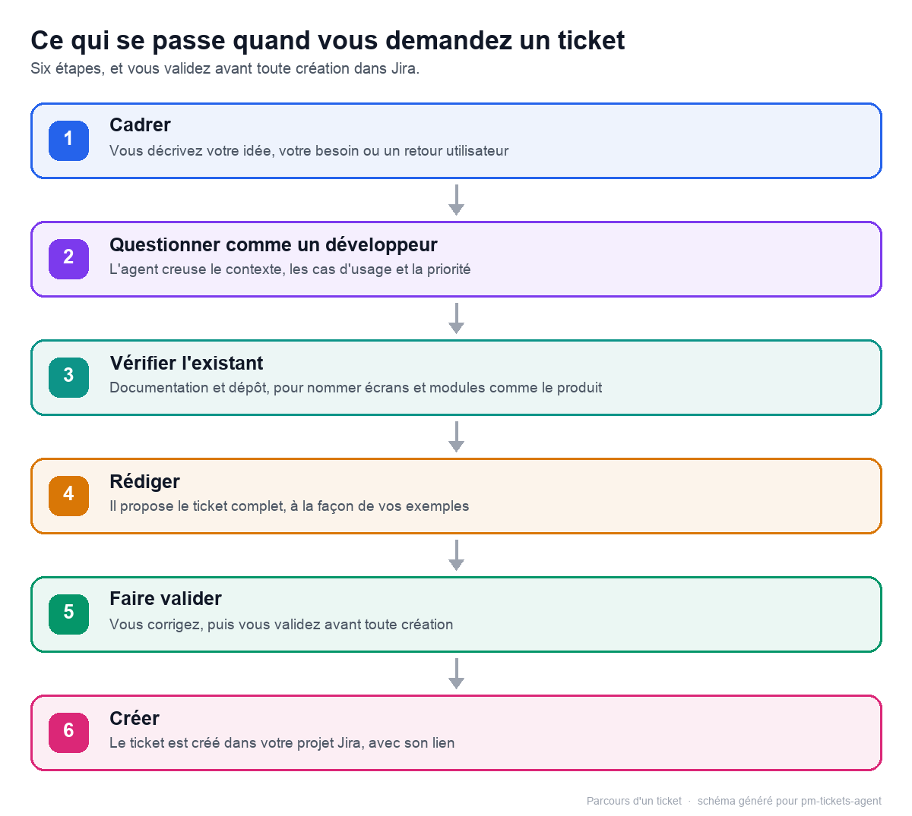
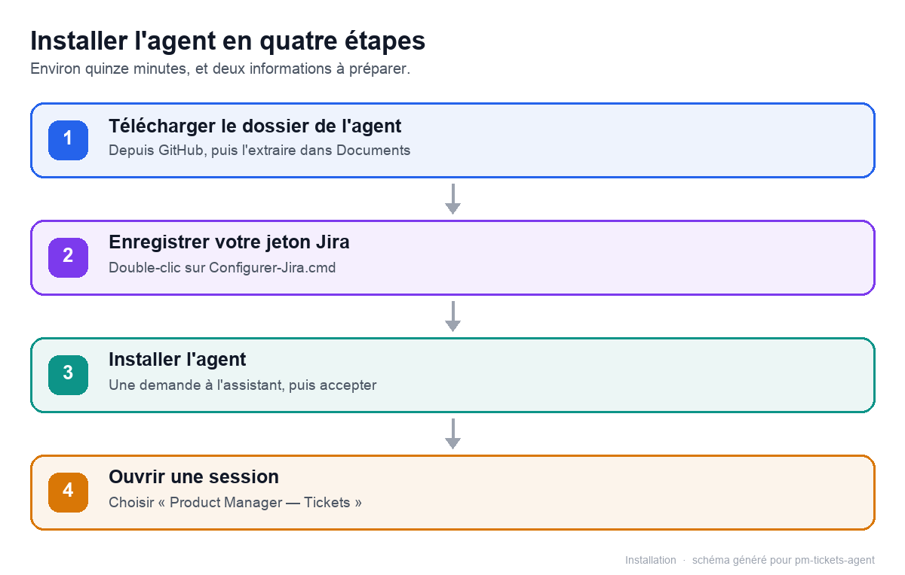

# Découvrir et installer l'agent

## En une minute

- L'agent « Product Manager — Tickets » transforme vos idées en tickets Jira complets, rédigés en français.
- Avant de rédiger, il pose les questions qu'un développeur poserait, puis il attend votre accord avant de créer quoi que ce soit.
- Comptez une quinzaine de minutes pour l'installer et démarrer votre première session.

## Ce que l'agent fait

- Il rédige un ticket complet à partir d'une idée, d'un besoin métier ou d'un retour utilisateur.
- Avant d'écrire, il se met à la place du développeur qui lira le ticket et pose jusqu'à six questions : cas limites et erreurs, données et formats, impact sur l'existant, droits, contraintes non fonctionnelles, testabilité.
- Un « je ne sais pas » devient une hypothèse ou une question ouverte, écrite dans le ticket.
- Il cherche les tickets proches pour éviter les doublons et propose de compléter l'existant.
- Il ne choisit jamais le projet à votre place : il crée uniquement dans le projet que vous avez configuré, après votre confirmation.
- Il ne gère ni les sous-tâches ni les sprints : il vous propose ces suites, vous les traitez dans Jira.

## Le déroulé d'une demande

1. **Cadrer** — l'agent reformule votre demande et précise le bénéfice visé.
2. **Questionner comme un développeur** — jusqu'à six questions ; vos réponses rendent le premier jet pertinent et vous préparent au refinement.
3. **Vérifier l'existant** — recherche des tickets proches, pour compléter ou éviter un doublon.
4. **Rédiger** — un ticket complet, avec les hypothèses et les questions ouvertes visibles.
5. **Faire valider** — vous relisez, vous corrigez, l'agent ajuste.
6. **Créer** — après votre confirmation, le ticket apparaît dans Jira avec sa clé et son lien.

Légende : votre demande traverse six étapes, du cadrage jusqu'à la création ; vous validez avant toute écriture dans Jira.

## Installer l'agent

Préparez trois choses : **DeepSeek Harness** installé sur votre poste, un **compte Atlassian
(Jira Cloud)** avec accès à votre projet Jira, et l'**accès au dépôt GitHub** `github.com/matleg29/Agent-ticket`
(dépôt privé — demandez l'accès au propriétaire avec votre compte GitHub).

Légende : quatre étapes, du téléchargement du dossier à la première session avec l'agent.

### 1. Télécharger le dossier de l'agent

- Ouvrez <https://github.com/matleg29/Agent-ticket>.
- Cliquez sur **Code**, puis **Download ZIP**.
- Faites un clic droit sur le ZIP téléchargé, puis **Extraire tout**.
- Renommez le dossier extrait en **`Agent-ticket`** et déplacez-le dans **Documents**.

Le chemin obtenu ressemble à `C:\Users\<votre-nom>\Documents\Agent-ticket`. **Ne le déplacez plus
ensuite** : l'agent s'installe depuis cet emplacement.

### 2. Créer et enregistrer votre jeton Jira

Un **jeton API Atlassian** est une clé personnelle qui permet à l'agent de parler à Jira en votre
nom. Il se crée une seule fois et se révoque à tout moment.

- Ouvrez <https://id.atlassian.com/manage-profile/security/api-tokens>.
- Cliquez sur **Create API token**, nommez-le par exemple `Agent PM Tickets`, puis **Create**.
- **Copiez immédiatement** la valeur affichée : elle ne sera plus jamais visible.

Puis, dans le dossier `Agent-ticket` :

- **Double-cliquez sur `Configurer-Jira.cmd`**.
- Saisissez votre e-mail Atlassian, le nom de votre site Jira (par exemple `mon-entreprise` pour
  `mon-entreprise.atlassian.net`), puis collez le jeton — il reste masqué à la saisie.
- **Double-cliquez sur `Verifier-Jira.cmd`** : le message « Connexion Jira OK » confirme que tout
  est prêt.

Le jeton est enregistré uniquement sur votre poste, dans
`C:\Users\<votre-nom>\.dsh\jira\credentials.env`. Il n'est jamais envoyé au modèle ni affiché dans la conversation.

### 3. Faire installer l'agent dans DeepSeek Harness

- Ouvrez **DeepSeek Harness**.
- Démarrez une conversation avec l'agent **Standard** (celui par défaut).
- Collez ce message, en remplaçant `<votre-nom>` par le vôtre :

  > Installe le bundle `C:\Users\<votre-nom>\Documents\Agent-ticket`

  Pour obtenir le chemin exact : maintenez **Maj** enfoncée, faites un clic droit sur le dossier
  `Agent-ticket`, puis choisissez **Copier en tant que chemin d'accès**.

- Acceptez l'autorisation « accès complet » demandée : installer un agent modifie la configuration
  de toutes vos conversations.
- Si DeepSeek Harness indique qu'un redémarrage est nécessaire, **quittez puis rouvrez
  l'application**.

### 4. Démarrer votre première session

- Créez une **nouvelle conversation**.
- Dans le sélecteur d'agent, choisissez **Product Manager — Tickets**.
- Écrivez votre première demande, par exemple : « Mes clients ne peuvent pas suivre l'avancement de
  leur commande ; je voudrais qu'ils voient le statut depuis leur compte. »

À la première conversation, l'agent pose quatre questions, dans cet ordre : votre projet Jira, vos
tickets types, votre documentation produit, votre dépôt GitHub. Pour le projet, la clé (par exemple
`BOUTIQUE`), le nom ou l'adresse suffit ; l'agent peut lister vos projets accessibles, et « je ne
sais pas encore » est une réponse valide : il vous demandera le projet au moment de la création.

## Avec macOS

Le parcours est le même, avec deux différences :

- enregistrez le jeton dans le Terminal, depuis le dossier de l'agent :
  `bash scripts/set-jira-credentials.sh`, puis vérifiez avec `bash scripts/check-jira.sh` ;
- à l'étape 3, donnez le chemin du dossier téléchargé (par exemple
  `/Users/<votre-nom>/Documents/Agent-ticket`).

## À retenir

- L'agent transforme un besoin en ticket complet ; rien n'est créé sans votre confirmation, dans le projet que vous avez configuré.
- Ses questions de refinement rendent le premier jet pertinent et préparent la discussion avec l'équipe.
- Le message « Connexion Jira OK » est le meilleur signe que l'installation a réussi.
