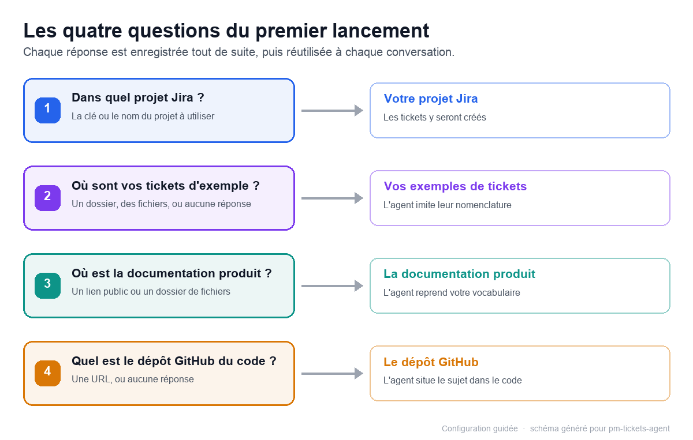

# Configurer l'agent : projet Jira, produit et exemples

## En une minute

- Au premier lancement, l'agent pose quatre questions dans l'ordre : votre projet Jira, vos tickets types, votre documentation produit, votre dépôt de code.
- Chaque réponse est enregistrée immédiatement, refus compris : « je n'en ai pas » n'est jamais redemandé.
- Tout est modifiable ensuite, sans réinstaller l'agent.

## Les quatre questions du premier lancement

Légende : chaque réponse alimente une source que l'agent relira avant de rédiger un ticket.

L'agent pose les questions dans l'ordre et attend une réponse à chacune avant de passer à la suivante.

### 1. Dans quel projet Jira dois-je créer vos tickets ?

- La clé du projet (par exemple BOUTIQUE), son nom ou son adresse suffit : l'un des trois convient.
- Vous ne connaissez pas votre clé ? Demandez la liste : l'agent affiche vos projets Jira accessibles (outil `jira_projects`), et vous n'avez plus qu'à choisir.
- « Je ne sais pas encore » est une réponse valide : l'agent demandera le projet au moment de créer votre premier ticket.
- Le projet configuré devient la cible de toutes les créations, et l'agent confirme avec vous avant chaque création.

### 2. Où sont vos tickets types ?

Un dossier, un ou plusieurs fichiers, ou « je n'en ai pas » : l'agent imite leur structure et leur ton, jamais leur contenu (voir « Apprendre à l'agent votre façon d'écrire »).

### 3. Où est la documentation produit ?

L'agent lit un lien http(s), un fichier Markdown ou un dossier de fichiers Markdown ; un PDF ou un document Word n'est pas lisible — il vous proposera un lien ou un export. Il en reprend votre vocabulaire et vos écrans.

### 4. Où est le dépôt GitHub du code ?

Une adresse de dépôt ou « pas de dépôt » : l'agent situe le sujet dans le code. Un dépôt privé demande une clé d'accès (GITHUB_TOKEN).

À la fin des quatre questions, l'agent résume en trois lignes ce qu'il a compris. Un refus est une réponse complète, jamais redemandée ; une source inaccessible est signalée, sans bloquer la suite.

## Vos réglages et où les trouver

Vos réponses sont conservées dans le fichier de réglages
`C:\Users\<votre-nom>\.dsh\pm-tickets\config.json`, dans votre dossier personnel.

Pour les modifier :

- demandez-le simplement à l'agent (« ma documentation est maintenant ici : … ») ;
- ou éditez le fichier à la main, si vous êtes à l'aise avec ce genre de fichiers.

Pour rejouer le parcours des quatre questions : `powershell -ExecutionPolicy Bypass -File
scripts\reset-product-context.ps1` sous Windows, `bash scripts/reset-product-context.sh` sous macOS.

## Apprendre à l'agent votre façon d'écrire

- Déposez deux ou trois tickets représentatifs par type (story, bug, tâche) : l'agent copie leur structure et leur vocabulaire, jamais leur contenu.
- Rangez-les dans le dossier `C:\Users\<votre-nom>\.dsh\pm-tickets\examples\`, ou copiez-les avec
  `powershell -ExecutionPolicy Bypass -File scripts\add-example.ps1 -Source C:\chemin\mon-ticket.md`
  sous Windows (`bash scripts/add-example.sh ~/Documents/mon-ticket.md story-mon-sujet.md` sous macOS).
- Un exemple collé dans la conversation est prioritaire ; vos exemples priment sur ceux livrés avec l'agent ; la prise en compte est immédiate.

## À retenir

- Quatre questions au premier lancement ; chaque réponse, refus compris, est enregistrée et jamais redemandée.
- Le projet Jira configuré est la cible de toutes les créations, avec une confirmation avant chaque ticket.
- Deux ou trois tickets types suffisent pour que l'agent écrive comme vous.
