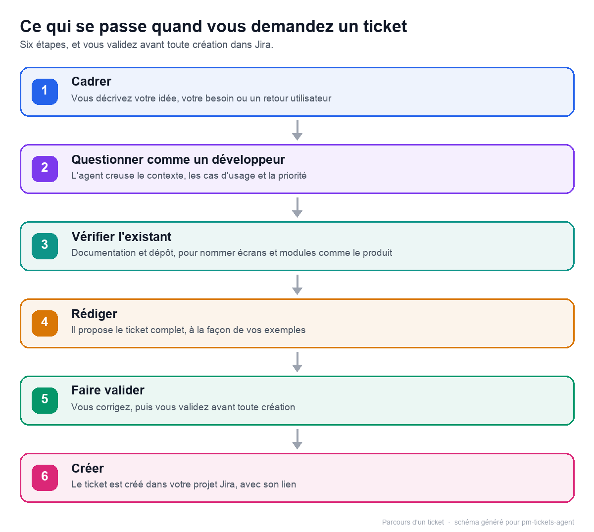

# Demander un ticket : le déroulé

Vous décrivez votre besoin avec vos mots ; cette page montre ce que l'agent en fait, jusqu'au ticket créé dans Jira.

## Le déroulé, étape par étape

Légende : votre demande avance d'étape en étape jusqu'à la création dans Jira ; vous validez avant toute écriture.

### 1. Cadrer

L'agent reformule votre demande pour vérifier qu'il a bien compris, puis identifie le persona concerné, le bénéfice attendu et le périmètre. S'il manque une information, il vous pose au plus trois questions.

### 2. Questionner comme un développeur

C'est l'étape la plus déterminante. Avant de rédiger, l'agent se met à la place du développeur qui recevra le ticket, et vous pose les questions que ce développeur poserait au refinement — la réunion où l'équipe passe un ticket en revue avant de coder. Jusqu'à six questions, chacune avec une proposition de réponse concrète, sur :

- les cas limites et les messages d'erreur ;
- les données manipulées et les formats attendus ;
- l'impact sur l'existant : ce qui change pour l'utilisateur, ce qui risque de casser ;
- les droits et permissions : qui peut voir et faire quoi ;
- les contraintes non fonctionnelles : performance, accessibilité, mobile… ;
- la testabilité : comment vérifier que c'est terminé.

Pourquoi cette étape ? Le premier jet du ticket est directement cohérent, et vous anticipez ce que les développeurs demanderont de toute façon au refinement. Ce sont vos réponses qui font la pertinence du ticket.

Une réponse vague, ou un simple « je ne sais pas », est parfaitement valide : la question devient une hypothèse nommée ou une question ouverte, écrite noir sur blanc dans le ticket.

Et rien ne se perd : vos réponses nourrissent le périmètre inclus, les critères d'acceptation, le hors périmètre et les risques.

### 3. Vérifier l'existant

L'agent relit vos tickets d'exemple et le contexte produit — votre documentation et votre dépôt de code. Il cherche aussi les tickets proches dans le projet Jira configuré, pour éviter de créer un doublon.

### 4. Rédiger

Il rédige le ticket complet, avec toutes les sections du gabarit, directement dans la conversation. Vos réponses aux questions de refinement sont intégrées, chacune à sa place.

### 5. Faire valider

Rien n'est créé sans votre accord. Vous demandez vos corrections ; l'agent représente alors le ticket complet, corrigé.

### 6. Créer

Après votre accord, il crée le ticket dans le projet Jira configuré. Vous recevez la clé et le lien, et l'agent vous propose des suites : un commentaire, des sous-tâches, un rangement dans le backlog.

## Trois conseils pour bien demander

- Donnez le contexte et le problème plutôt que la solution : l'agent construit la suite à partir de ce qui vous bloque.
- Répondez précisément aux questions de refinement, ou dites clairement « je ne sais pas » : l'inconnue sera écrite dans le ticket, jamais devinée.
- Relisez les critères d'acceptation avant de valider : c'est sur eux que l'équipe saura que le travail est terminé.

## À retenir

- Avant de rédiger, l'agent vous pose les questions qu'un développeur poserait au refinement.
- Chaque réponse, même « je ne sais pas », se retrouve dans le ticket : périmètre, critères, risques.
- Vous validez le ticket complet avant toute création dans Jira.
