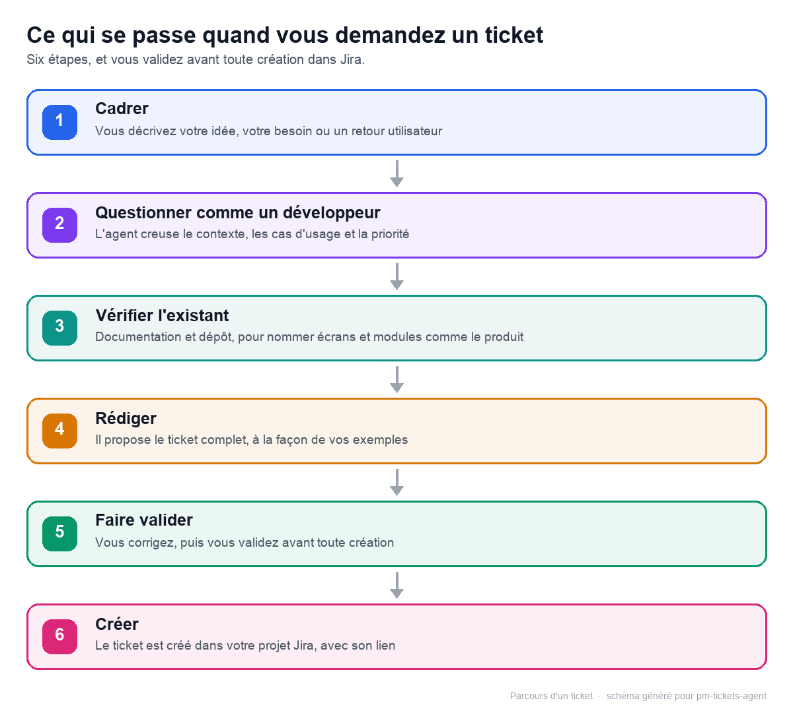
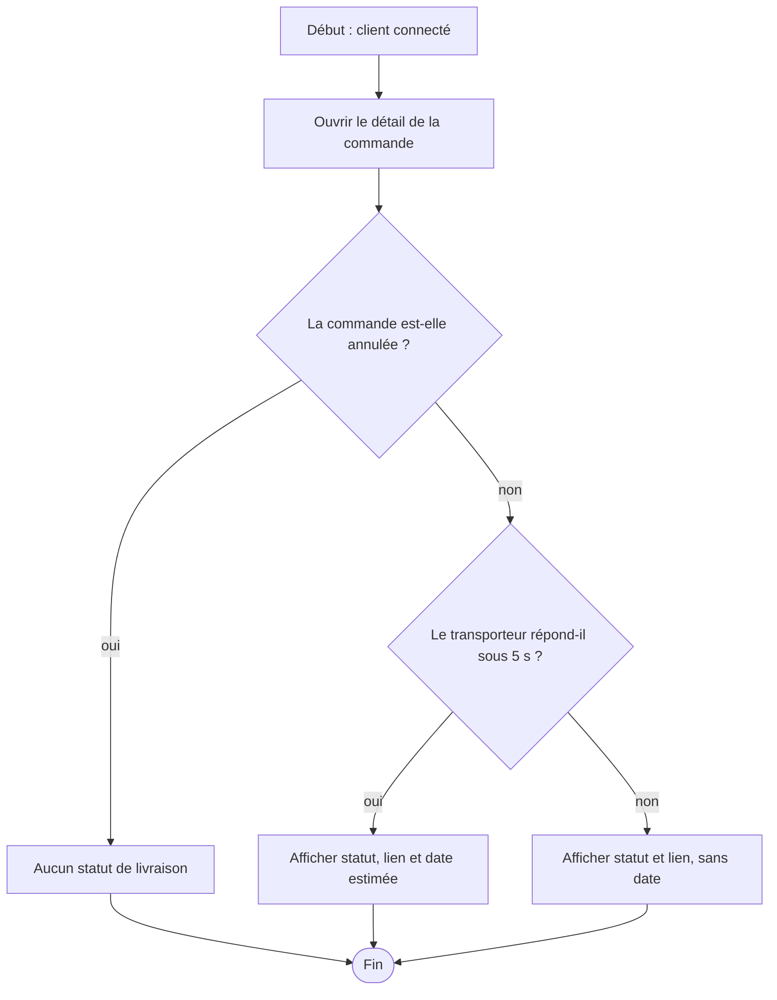

# Demander un ticket : le déroulé

Vous décrivez votre besoin avec vos mots ; cette page montre ce que l'agent en fait, jusqu'au ticket créé dans Jira.

## Le déroulé, étape par étape


Légende : votre demande avance d'étape en étape jusqu'à la création dans Jira ; vous validez avant toute écriture.

### 1. Cadrer

L'agent reformule votre demande pour vérifier qu'il a bien compris, puis identifie le persona concerné, le bénéfice attendu et le périmètre. S'il manque une information, il vous pose au plus trois questions.

### 2. Questionner comme un développeur

C'est l'étape la plus déterminante. Avant de rédiger, l'agent se met à la place du développeur qui recevra le ticket, et vous pose les questions que ce développeur poserait au refinement — la réunion où l'équipe passe un ticket en revue avant de coder. Jusqu'à six questions, chacune avec une proposition de réponse concrète, sur :

- les cas limites et les messages d'erreur ;
- les données manipulées et les formats attendus ;
- l'impact sur l'existant : ce qui change pour l'utilisateur, ce qui risque de casser ;
- les droits et permissions : qui peut voir et faire quoi ;
- les contraintes non fonctionnelles : performance, accessibilité, mobile… ;
- la testabilité : comment vérifier que c'est terminé.

Pourquoi cette étape ? Le premier jet du ticket est directement cohérent, et vous anticipez ce que les développeurs demanderont de toute façon au refinement. Ce sont vos réponses qui font la pertinence du ticket.

Une réponse vague, ou un simple « je ne sais pas », est parfaitement valide : la question devient une hypothèse nommée ou une question ouverte, écrite noir sur blanc dans le ticket.

Et rien ne se perd : vos réponses nourrissent le périmètre, les critères d'acceptation, le hors périmètre et les risques.

### 3. Vérifier l'existant

L'agent relit vos tickets d'exemple et le contexte produit — votre documentation et votre dépôt de code. Il cherche aussi les tickets proches dans le projet Jira configuré, pour éviter de créer un doublon. S'il trouve un ticket très proche, il vous donne son lien et s'arrête là : c'est vous qui le complétez dans Jira, l'agent ne le modifie pas.

### 4. Rédiger

Il rédige le ticket dans la conversation, selon le gabarit à puces (voir [Le gabarit du ticket](#le-gabarit-du-ticket)). Vos réponses aux questions de refinement sont intégrées, chacune à sa place.

Il termine par un **logigramme fonctionnel** : le parcours du besoin, étape par étape, avec ses décisions, ses variantes et ses erreurs (voir [Le logigramme fonctionnel](#le-logigramme-fonctionnel)).

### 5. Relire avant d'afficher

Avant de vous le montrer, l'agent reprend le ticket et vérifie huit points. Ce qui échoue est corrigé : vous ne voyez que ce qui passe.

- chaque critère est testable sans interprétation : aucun adjectif subjectif, aucune valeur floue ;
- au moins un cas limite, et un cas d'erreur dès que le parcours peut échouer ;
- les exigences non fonctionnelles sont tranchées : section remplie, ou omission justifiée en **Notes** ;
- chaque hypothèse porte son impact si elle est fausse ;
- aucune redite entre **Contexte**, **Périmètre** et **User story** ;
- chaque branche du logigramme correspond à un critère, et réciproquement ;
- aucun « etc. », « TBD », « à définir », adjectif creux, section vide ; le budget de caractères est respecté ;
- le **Résumé** fait 100 caractères au plus et décrit le résultat attendu, pas la solution technique.

### 6. Faire valider

Rien n'est créé sans votre accord. Vous demandez vos corrections ; l'agent représente alors le ticket, corrigé.

La validation porte sur le ticket **et** sur son logigramme : si le parcours ne correspond pas à ce que vous attendez, c'est le moment de le dire.

### 7. Créer

Après votre accord, il crée le ticket dans le projet Jira configuré. Il dépose aussitôt le logigramme en commentaire du ticket, puis vous rend la clé et le lien du ticket. Il vous indique enfin les suites utiles côté Jira — sous-tâches, ticket lié, rangement dans le backlog : **c'est vous qui les faites**, l'agent ne touche pas au ticket après sa création.

## Droits sur Jira : création seule

- L'agent **crée** des tickets. C'est tout.
- Il ne modifie **jamais** un ticket existant : ni résumé, ni description, ni statut, ni priorité, ni libellé, ni assignation, ni pièce jointe.
- Il ne supprime **jamais** de ticket.
- Seule écriture sur un ticket existant : le commentaire du logigramme, sur **le ticket qu'il vient de créer** dans la conversation en cours. Jamais sur un ticket créé par quelqu'un d'autre.
- Un changement est nécessaire ? L'agent décrit en une ou deux phrases ce qu'il faudrait changer, **vous donne le lien** (`.../browse/CLÉ`) et vous demande de le faire vous-même dans Jira.

Ce que vous verrez, en substance : « Je ne modifie pas les tickets existants. Voici le lien : <URL>. La modification est à faire côté Jira, par vous. »

Le refus est stable et expliqué une fois, sans leçon de morale. Il n'y a pas de « je le fais pour cette fois ».

## Le gabarit du ticket

Toujours le même ordre. Puces, pas de paragraphes rédigés.

1. **Résumé** — une phrase, 100 caractères au plus, à l'infinitif ou nominal, sans préfixe de type.
2. **Contexte** — 2 à 4 puces : qui est concerné, situation actuelle, impact.
3. **User story** — une phrase : « En tant que <persona>, je veux <capacité>, afin de <bénéfice>. »
4. **Périmètre** — 3 à 6 puces, verbes d'action, sans redire le contexte.
5. **Critères d'acceptation** — Gherkin français, une ligne par critère : `Étant donné … / Quand … / Alors …`. Au minimum un cas nominal, plus un cas limite et un cas d'erreur dès que le parcours peut échouer ; 8 critères au maximum. Chaque critère porte une valeur observable : un seuil, un message, un état, un délai.
6. **Exigences non fonctionnelles** — puces : performance, volumétrie, accessibilité, mobile, langue, sécurité, conservation des données. Section **omise** seulement si aucune ne s'applique, et l'omission se justifie alors par une puce de **Notes**. Jamais d'omission silencieuse.
7. **Hors périmètre** — puces. Section **omise** si elle est vide.
8. **Hypothèses et questions ouvertes** — une ligne par hypothèse, au format `Hypothèse : <énoncé> — si faux, alors <impact concret>.` Une question ouverte non bloquante y figure avec la personne qui doit y répondre. Section **omise** si le ticket n'en contient aucune.
9. **Risques et dépendances** — puces : tickets liés, équipes, contraintes. Section **omise** si elle est vide.
10. **Notes** — puces : liens, maquettes, source (`Source : <conversation / e-mail du … / ticket support #…>`), demandeur (`Demandeur : <rôle>`). Section **omise** si elle est vide.

Les sections 6 à 10 sont les seules facultatives : une section vide est une faute de style, son absence n'en est pas une. Après le ticket, et **hors de la description**, l'agent donne toujours les deux lignes de décision : `Type proposé : Story | Task | Bug — <justification>` et `Priorité proposée : <niveau> — <justification>`.

Règles de concision :

- Une idée = une puce = une ligne. Pas de puce de plus de deux lignes.
- Pas de phrase d'introduction, pas de reformulation de la demande, pas de résumé final, pas de redite entre sections.
- Budget indicatif : description **≤ 2 200 caractères** hors logigramme. Si ça dépasse, coupez dans cet ordre : **Notes**, puis **Hors périmètre**, puis **Contexte**. Jamais dans les critères d'acceptation, les exigences non fonctionnelles ni les hypothèses : si ça déborde là, c'est le ticket qu'il faut découper.
- Le format des critères est **imposé** : Gherkin français, une ligne par critère.
- La structure vient du **gabarit** : vos exemples fournissent le vocabulaire, le ton et le niveau de détail, jamais une section ajoutée, retirée ou renommée.
- Pas d'adjectif creux, pas de « etc. », pas de « TBD », pas de section vide.
- La « Definition of Done » séparée n'existe plus : ce qui reste utile va dans une puce de **Notes**.
- Le logigramme fonctionnel reste **hors** de la description : il part en commentaire du ticket créé.

### Exemple de ticket court

```markdown
## Résumé
Suivre l'avancement de sa commande depuis son compte

## Contexte
- Le client ne reçoit qu'un e-mail de confirmation après sa commande.
- Le support traite environ 40 demandes « où est ma commande » par semaine.
- Le client n'a aucune visibilité sur la préparation et l'expédition.

## User story
En tant que client ayant commandé, je veux suivre l'avancement de ma commande, afin de savoir quand elle sera livrée sans contacter le support.

## Périmètre
- Afficher le statut de la commande sur la page de détail.
- Afficher la date de livraison estimée quand le transporteur la fournit.
- Afficher le lien de suivi transporteur quand un numéro existe.

## Critères d'acceptation
- Étant donné une commande payée avec un numéro de suivi, quand le client ouvre le détail, alors le statut, le lien de suivi et la date estimée s'affichent.
- Étant donné une commande annulée, quand le client ouvre le détail, alors aucun statut de livraison ne s'affiche.
- Étant donné un transporteur sans réponse sous **5 secondes**, quand le client ouvre le détail, alors le statut et le lien s'affichent sans la date estimée.

## Exigences non fonctionnelles
- Afficher la page en **2 secondes** au plus, transporteur indisponible compris.
- Rester lisible sur mobile, à partir de **360 px** de large.
- Conserver l'historique des statuts **12 mois**.

## Hors périmètre
- Notifications push ou SMS à chaque changement de statut.
- Suivi de la position du colis en temps réel.

## Hypothèses et questions ouvertes
- Hypothèse : le transporteur renvoie un statut normalisé — si faux, alors seul le statut de la boutique s'affiche.
- Question ouverte : historique complet des statuts ou statut courant seulement — à trancher par le responsable support.

## Risques et dépendances
- Date estimée fournie par l'API transporteur : disponibilité variable selon le transporteur.

## Notes
- Maquette : écran « Suivi de commande ».
- Source : conversation du 12 novembre.
- Demandeur : responsable support.
```

Puis, hors de la description, les deux lignes de décision :

```text
Type proposé : Story — parcours client visible, valeur directe.
Priorité proposée : Haute — 40 demandes support par semaine.
```

Environ 2 000 caractères pour la description, sous le budget de 2 200 : le développeur lit ce ticket en 30 secondes.

### Écrire un bon ticket

Le fond d'abord, la forme ensuite. Un développeur lit le ticket en 30 secondes et commence à travailler sans reposer de question.

- **Exhaustif, pas bavard.** Tout ce qui sert à décider, cadrer ou coder. Rien de plus.
- **Phrases courtes.** Une idée par phrase, 20 mots au maximum, voix active.
- **Puces, jamais de paragraphe.** Une puce fait une à deux lignes. Seuls le **Résumé** et la **User story** sont des phrases rédigées.
- **Le gras sur ce qui décide.** Valeurs, seuils, statuts, limites : deux ou trois éléments par section au plus.
- **Un seul mot par concept.** Le même terme du début à la fin, le terme du produit quand il existe.
- **Verbes à l'infinitif** dans le **Périmètre** et les critères : ce que le système fait, pas ce qu'il faudrait faire.
- **Aucun méta-discours.** Pas de « comme demandé », pas de « voici le ticket », pas de commentaire sur la demande.

## Le logigramme fonctionnel

Un logigramme fonctionnel, c'est le parcours du besoin dessiné du point de vue de l'utilisateur : une case de départ, les étapes, les décisions, les variantes et les cas d'erreur. Il complète les critères d'acceptation : ceux-ci disent quoi vérifier, le logigramme montre dans quel ordre et dans quels cas.

Il est présenté en deux versions, dans le même commentaire :

1. **une version texte**, en caractères monospace, qui s'affiche dans tous les Jira sans rien installer ;
2. **un source Mermaid**, pour les équipes qui utilisent une application de diagrammes. Jira Cloud ne dessine pas Mermaid de lui-même : sans application, le source reste affiché en clair, tandis que la version texte ci-dessus reste lisible partout.

Exemple, pour un ticket « suivre sa commande » :

```text
[Début : client connecté]
│
▼
[Ouvrir le détail de la commande]
│
▼
{La commande est-elle annulée ?}
├─oui─▶ [Aucun statut de livraison] ──▶ [Fin]
└─non─▶ {Le transporteur répond-il sous 5 s ?}
        ├─oui─▶ [Afficher statut, lien et date estimée] ──▶ [Fin]
        └─non─▶ [Afficher statut et lien, sans date] ──▶ [Fin]
```



Quelques règles :

- il ne va jamais dans la description du ticket : il reste en commentaire, pour ne pas alourdir le ticket ;
- il se déduit des critères d'acceptation : une branche correspond à un critère, et chaque critère figure dans le logigramme ;
- il n'est déposé qu'en commentaire du ticket que l'agent vient de créer dans cette conversation, jamais sur un ticket existant ;
- il ne décrit que ce que le ticket couvre, jamais le hors-périmètre ;
- il nomme les écrans et les statuts comme votre produit, pas comme le code ;
- pour un ticket sans parcours utilisateur (refactoring, tâche d'infrastructure, correction de libellé), il n'y a pas de logigramme : l'agent l'écrit en une phrase.

## Trois conseils pour bien demander

- Donnez le contexte et le problème plutôt que la solution : l'agent construit la suite à partir de ce qui vous bloque.
- Répondez précisément aux questions de refinement, ou dites clairement « je ne sais pas » : l'inconnue sera écrite dans le ticket, jamais devinée.
- Relisez les critères d'acceptation avant de valider : c'est sur eux que l'équipe saura que le travail est terminé.

## À retenir

- Avant de rédiger, l'agent vous pose les questions qu'un développeur poserait au refinement.
- Chaque réponse, même « je ne sais pas », se retrouve dans le ticket : périmètre, critères, risques.
- Le ticket est synthétique : à puces, dix sections, 2 200 caractères au plus, sections facultatives omises quand elles sont vides.
- L'agent crée, il ne modifie ni ne supprime jamais : pour un changement, il vous donne le lien et vous le faites dans Jira.
- Chaque ticket se termine par un logigramme fonctionnel, déposé en commentaire du ticket créé : en texte lisible partout, et en source Mermaid pour les équipes équipées d'une application de diagrammes.
