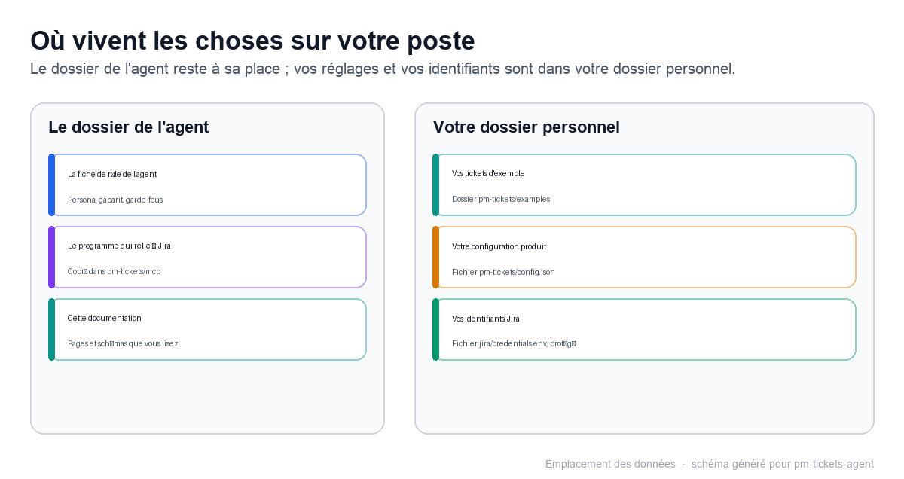

# Pour aller plus loin : outils et architecture

## En une minute

- L'agent ne fait rien « tout seul » : il dispose de dix actions très précises, dont six parlent à Jira et quatre gèrent le contexte et la configuration.
- Trois pièces suffisent à le faire fonctionner : une fiche de rôle, un petit programme local qui parle à Jira, et vos réglages.
- Vos identifiants et vos réglages restent dans votre dossier personnel ; le programme local y est copié pour être lancé par DeepSeek Harness.

## Les dix actions de l'agent

Chaque action porte un nom technique ; le tableau suivant décrit ce qu'elle fait pour vous.

| Outil | Ce qu'il fait |
|---|---|
| `jira_search` | Cherche des tickets par requête JQL, pour repérer un doublon ou une convention |
| `jira_get_issue` | Lit un ticket existant : résumé, description, statut… |
| `jira_create_issue` | Crée un ticket ; la description en Markdown est convertie automatiquement |
| `jira_add_comment` | Ajoute un commentaire à un ticket existant ; les blocs de code `text` et `mermaid` y sont conservés, c'est le canal du logigramme fonctionnel |
| `jira_create_meta` | Liste les types de ticket disponibles dans un projet |
| `jira_projects` | Liste les projets Jira accessibles, pour choisir ou vérifier le projet cible |
| `ticket_examples` | Renvoie les tickets de référence dont l'agent imite la nomenclature |
| `setup_read` | Lit l'état de la configuration : projet Jira, documentation, dépôt, exemples |
| `setup_save` | Enregistre une réponse de configuration |
| `product_context` | Lit la documentation produit et le dépôt GitHub pour ancrer le ticket |

## Comment l'agent fonctionne

- Trois pièces : la fiche de rôle du product manager (le comportement attendu), le petit programme
  local qui parle à Jira — le serveur MCP —, et vos réglages.
- La fiche de rôle reste dans le dossier de l'agent. Le programme qui parle à Jira y est copié, au
  premier chargement, dans `C:\Users\<votre-nom>\.dsh\pm-tickets\runtime\mcp\`, pour pouvoir être lancé
  par DeepSeek Harness. Il n'est jamais copié dans le profil de l'application.
- Vos identifiants Jira sont lus dans `C:\Users\<votre-nom>\.dsh\jira\credentials.env`, dans votre
  dossier personnel.
- Vos réglages sont enregistrés dans `C:\Users\<votre-nom>\.dsh\pm-tickets\config.json`.
- Vos secrets n'apparaissent jamais dans la conversation : le programme les lit directement sur votre machine.

## Où vivent vos données

| Donnée | Où elle vit |
|---|---|
| Vos identifiants Jira | `C:\Users\<votre-nom>\.dsh\jira\credentials.env` |
| Vos réglages | `C:\Users\<votre-nom>\.dsh\pm-tickets\config.json` |
| Vos exemples de tickets | `C:\Users\<votre-nom>\.dsh\pm-tickets\examples\` |
| La fiche de rôle | Le dossier de l'agent, sans aucun secret à l'intérieur |
| Le programme qui parle à Jira | `C:\Users\<votre-nom>\.dsh\pm-tickets\runtime\mcp\jira-mcp.mjs` |

Vos identifiants et vos réglages restent dans votre dossier personnel. Les contenus que vous confiez à l'agent sont traités par le modèle de DeepSeek Harness, comme dans toute conversation ; le programme local ne contacte que votre espace Jira et, si vous l'avez configuré, l'API GitHub.

Légende : le dossier de l'agent contient la fiche de rôle ; le programme est copié dans votre dossier personnel, avec vos identifiants, vos réglages et vos exemples.

## À retenir

- Dix actions : l'agent lit avant d'écrire, ne peut rien supprimer ni modifier, et attend votre accord avant de créer.
- Vos données restent dans votre dossier personnel ; rien n'est envoyé ailleurs qu'à votre espace Jira et à votre dépôt GitHub.
